# 1D Saint-Venant River Routing

### 👉 [**Open the live interactive app**](https://biswashk920.github.io/1D-Saint-Venant-River-Routing/) &nbsp;·&nbsp; runs in your browser, nothing to install

A validated finite-volume solver for the 1D shallow-water (Saint-Venant) equations, built for **dam breaks, flood
routing and glacial-lake outburst floods (GLOFs)** in channels of **any prismatic cross-section** (rectangular,
trapezoidal, V-shaped valley, compound channel with floodplain). It comes with a Python reference implementation,
an identical JavaScript port, and an interactive app with a **3D view**, a **space-time surface** and exact
analytical overlays.

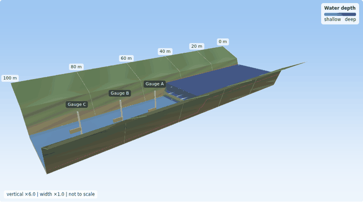

<p align="center">
<a href="https://biswashk920.github.io/1D-Saint-Venant-River-Routing/"><b>Live app</b></a> ·
<a href="docs1/METHODS.md">Methods</a> ·
<a href="docs1/VALIDATION.md">Full validation results</a> ·
<a href="#quick-start">Quick start</a> ·
<a href="LICENSE.md">MIT license</a>
</p>

## What you can do in the app

| | |
|---|---|
| **Scenarios** | Dam break on a dry bed, dam break on a wet bed, flood routing with an inflow hydrograph, GLOF / landslide-dam failure, and a Thacker oscillating lake with a moving shoreline |
| **Cross-sections** | Rectangular, trapezoid, V-shaped valley, compound (channel plus floodplain). The flood spreads across the banks according to the section width at the computed depth |
| **Views** | Profile (2D), **3D valley** with orbit camera and half-section cut-away, and a **space-time surface** of depth h(x, t) |
| **Physics overlays** | The exact analytical solution drawn over the numerical one (dashed in 2D, pink in 3D) for flat, frictionless dam breaks in any section |
| **Engineering layers** | Depth, velocity, Froude number, and flood hazard (depth × velocity) |
| **Gauges** | Three posts report threshold-trip arrival time, peak depth and peak depth × velocity; flags turn green, amber or red |
| **Interaction** | Sliders for every parameter, time scrubbing, depth probes, vertical and width exaggeration, flow streaks, follow-the-front camera |
| **Sharing** | *Copy link* encodes the whole scenario in the URL; *Record clip* saves a WebM video of the 3D view |

<table>
<tr>
<td>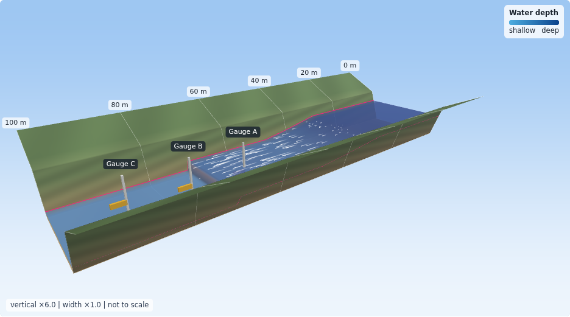</td>
<td>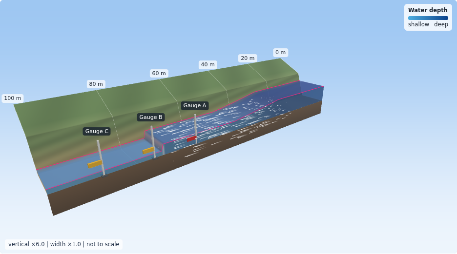</td>
</tr>
<tr>
<td>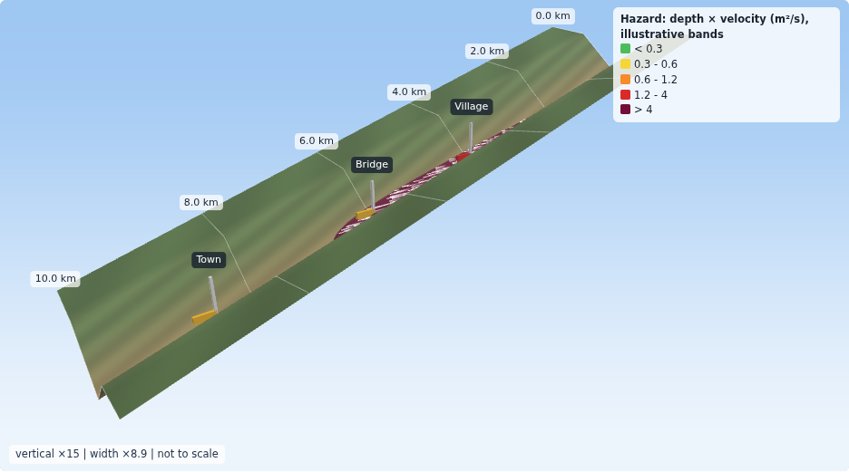</td>
<td>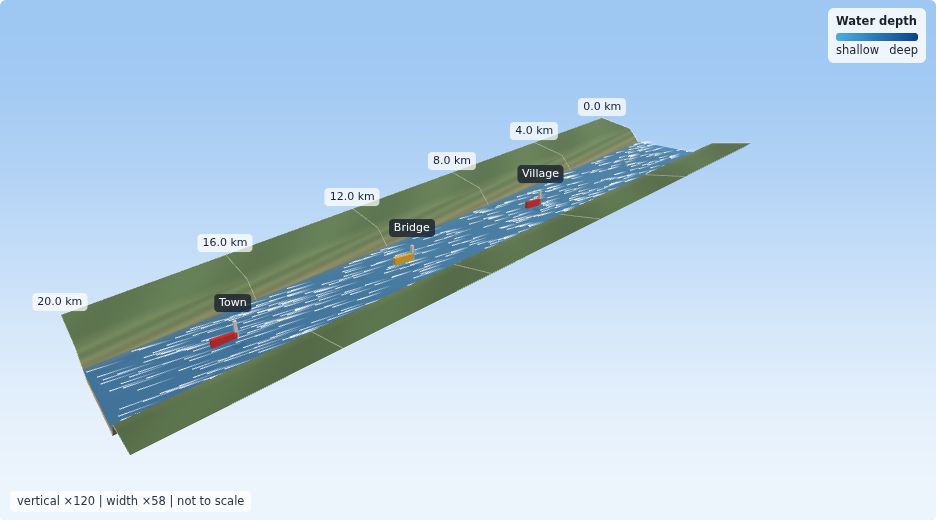</td>
</tr>
<tr>
<td>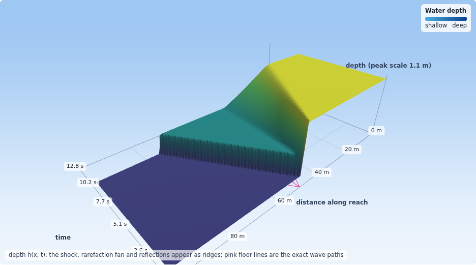</td>
<td>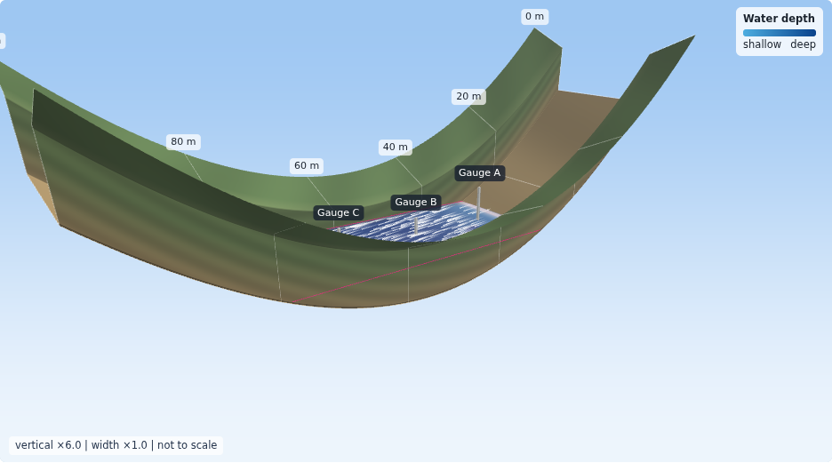</td>
</tr>
</table>

> **The 3D view is a rendering of a 1D solution**, not a 2D simulation. Water depth, velocity and discharge come
> from the 1D solver; the lateral extent of the water is the cross-section width B(h) at that depth. Vertical and
> width exaggeration are shown on the view. For real 2D inundation mapping use a 2D model.

## Methods in brief

Unknowns are flow area `A` and discharge `Q`:

```
dA/dt + dQ/dx = 0
dQ/dt + d( Q²/A + g·I1(h) )/dx = −g·Ā·dz/dx − g n² |Q| Q P^(4/3) / A^(7/3)
```

with `I1(h) = ∫₀ʰ A dη` the hydrostatic pressure integral of the section. Full derivations are in
[docs1/METHODS.md](docs1/METHODS.md).

| Component | Choice | Why |
|---|---|---|
| Discretisation | Finite volume, Godunov-type | Captures bores and shocks without the wiggles of implicit Preissmann schemes |
| Riemann solver | HLL, Einfeldt speeds, **exact dry-front speeds** from the Riemann invariant | Correct wave-tip speed in every cross-section |
| Spatial order | MUSCL on (η, u, z), minmod limiter | Second order in smooth regions without oscillations |
| Bed slope | Audusse hydrostatic reconstruction with a **pressure-consistent source** | **Exactly well-balanced in any section**: a lake at rest stays at rest to round-off |
| Positivity | Flux limiter: a cell cannot export more water than it holds | Exact mass conservation with moving shorelines, no negative depths |
| Time stepping | SSP-RK2 (Heun), adaptive CFL 0.4 | |
| Friction | Fully implicit Manning, **exact quadratic solve**, applied per substep | Uniform flow is reproduced to round-off; stable at wet/dry fronts |
| Cross-sections | Piecewise-linear width B(h); A, I1, P and h(A) in closed form | Pressure force is exact for non-rectangular sections |
| Boundaries | wall, open, prescribed discharge hydrograph, prescribed depth | |

### How it was built and checked

1. **Sections first.** Every closed form (area, pressure integral, perimeter, inverse, Riemann invariant) is
   unit-tested against hand-derived results.
2. **Independent exact solutions.** Ritter and Stoker are generalised to any prismatic section with the Riemann
   invariant and the bore jump conditions, and implemented separately from the solver. They reduce to the textbook
   formulas for a rectangle (also tested).
3. **Fix causes, not tolerances.** Three problems found by the tests shaped the scheme: mass created by flooring
   negative areas (now a positivity flux limiter), a 0.2% uniform-flow drift (now exact implicit friction), and a
   boundary mismatch (friction now applied in every Heun substep).
4. **JavaScript port, line for line**, checked against Python on 16 reference cases.
5. **Real-browser test.** The whole app runs in headless Chromium: numerics, every scenario and section in 2D, 3D
   and space-time, layers, cut-away, camera, gauges, share links, clip recording, clean console.
6. **CI** runs all of this on every push and deploys the app to GitHub Pages.

## Validation

All of it runs in CI. Complete tables: [docs1/VALIDATION.md](docs1/VALIDATION.md). Headline numbers, measured:

| Test | Result |
|---|---|
| Lake at rest over an uneven bed, 4 sections | surface deviation ≤ 2.4e-15 m, discharge ≤ 1.1e-13 m³/s |
| Dam break vs generalised **Ritter** and **Stoker**, 4 sections | L1 depth error 1.2 to 1.3 mm on 400 cells (3.4 mm for the V-valley dry tip) |
| Mass conservation, dam breaks | relative error ≤ 2e-16 |
| Grid convergence | observed order 0.98 to 1.01 (first order, as expected with a shock) |
| **Thacker** oscillating lake, moving shoreline | L1 error 0.2 mm after one period (400 cells); mass error 3e-16 |
| Uniform flow in rectangular, trapezoidal, compound sections | depth deviation ≤ 1.1e-15, discharge ≤ 1.4e-14 |
| Relaxation to Manning normal depth (trapezoid) | deviation below 0.01% after 8000 s |
| Manufactured steady state (varying bed, friction) | max relative depth error 0.014% |
| Steep, rough, dry GLOF valley | no negative depths, no NaN, no water created |
| JavaScript vs Python (16 cases) | 13 cases agree to 3e-15 or better; the three friction cases to 3e-13, 3e-10 and 1.2e-8 (rounding differences in `pow`, bounded, not growing); tolerance 1e-7 |
| Chromium | same numbers as Python; 33 end-to-end checks pass |

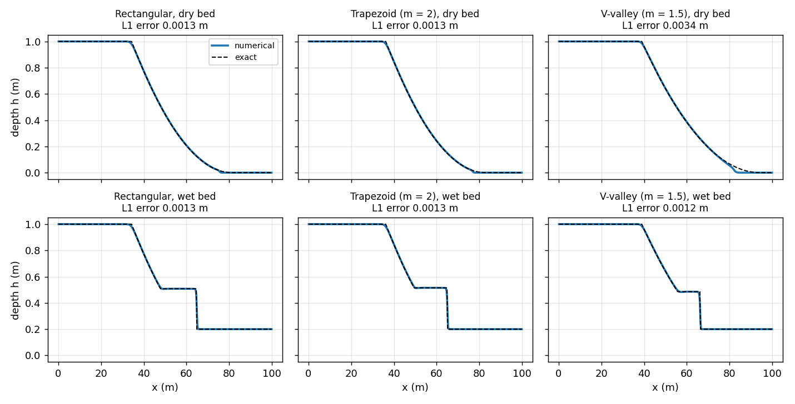
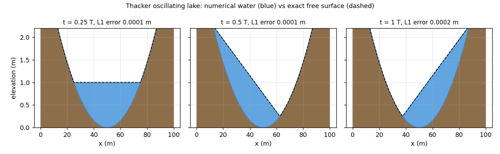
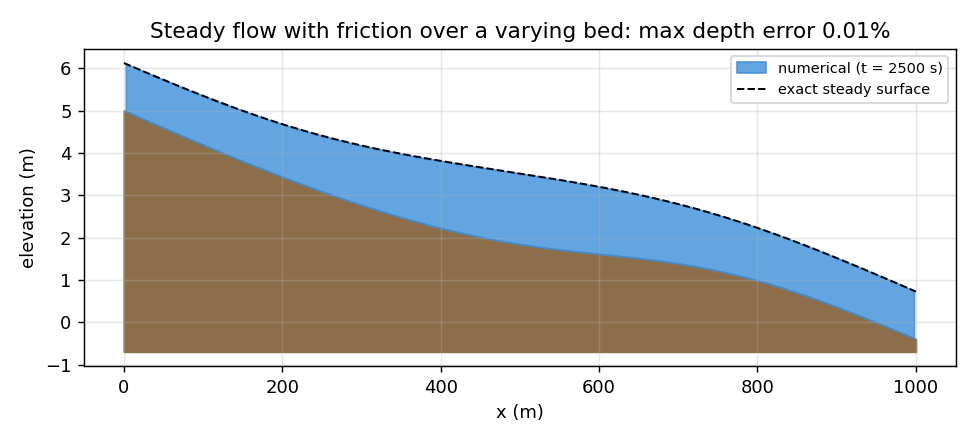
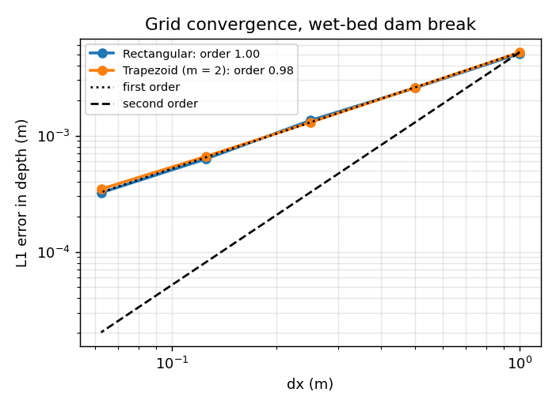

## Quick start

**Anaconda (Windows, macOS, Linux):**

```bash
conda create -n svroute python=3.12 numpy matplotlib pytest -y
conda activate svroute
pip install -e .
pytest -v                       # 28 validation tests
```

**Plain Python:**

```bash
python -m venv .venv && source .venv/bin/activate      # Windows: .venv\Scripts\activate
pip install -e ".[dev]"
pytest -v
```

**Use the solver:**

```python
from svroute import dam_break, stoker, trapezoid

sec = trapezoid(b=5.0, m=2.0)                       # bottom width 5 m, side slope 2:1
s = dam_break(sec, N=400, L=100.0, x0=50.0, h_up=1.0, h_down=0.2)
s.run(5.0)
h_exact, u_exact = stoker(s.xc, 5.0, 50.0, 1.0, 0.2, sec)
print(abs(s.hc - h_exact).mean())                   # about 1.3 mm
```

**Run the app locally:**

```bash
cd web
python -m http.server 8000      # open http://localhost:8000
```

**Cross-check the JavaScript port and test the app (needs Node 18+):**

```bash
python scripts/make_reference.py
node web/test/compare.js        # JS vs Python on 16 cases
node web/test/presets.js        # every scenario x section stays finite and conserves mass
npm install --no-save playwright && npx playwright install chromium
node web/test/browser.js        # end-to-end test in Chromium
```

**Regenerate figures and animations:** `python scripts/validation_plots.py`, `python scripts/validation_report.py`,
`python scripts/make_gif.py`.

## Repository layout

```
src/svroute/     section.py (cross-sections), solver.py (scheme), analytical.py (exact solutions), scenarios.py
tests/           validation suite (pytest, 28 tests)
scripts/         validation figures and report, reference data for the JS port, animations
web/             index.html, ui.js, view3d.js + gl.js (WebGL renderer, no dependencies),
                 solver.js + section.js + exact.js (JS port), scenarios.js
web/test/        compare.js (JS vs Python), presets.js (stability), browser.js (Chromium end to end)
docs1/            METHODS.md, VALIDATION.md, figures
.github/         CI: tests, browser test, deploy to GitHub Pages
```

## Limitations (read before using for anything real)

- **Prismatic channels only.** The cross-section is constant along the reach. Real rivers need surveyed,
  varying sections (a DEM-derived extension is the next milestone).
- **1D.** No lateral flow, no backwater from side channels, no 2D inundation. The 3D view draws the 1D result.
- **Symmetric sections** defined by width versus depth. No overbank storage separate from conveyance.
- **No bridge, culvert, weir or gate hydraulics**; the gauge posts are monitoring points, not structures.
- **The GLOF scenario is an instantaneous failure**, the worst-case limit. Real breaches grow over time, and
  moraine-dam breach modelling is a separate problem.
- **Accuracy:** first order at shocks, second order in smooth flow. Dry fronts are clipped at 1e-4 m, which
  shortens the thinnest tip of a wave slightly; velocity error near a dry tip is larger (0.3 to 0.8 m/s L1 for
  the dry-bed dam break) while depth is accurate.
- **Hazard bands are illustrative**, not a regulatory standard.
- **Not validated against field data or HEC-RAS yet.** Validation is against exact solutions and engineering
  benchmarks.
- Roughness is a single Manning n for the whole section.

## Roadmap

- [ ] Surveyed, varying cross-sections (DEM-derived A(h), B(h) per station)
- [ ] HEC-RAS unsteady comparison on the same cases
- [ ] Gradual breach hydrograph for the GLOF scenario
- [ ] Composite roughness for compound sections

## License

[MIT](LICENSE.md). References are listed in [docs1/METHODS.md](docs1/METHODS.md#7-references).
